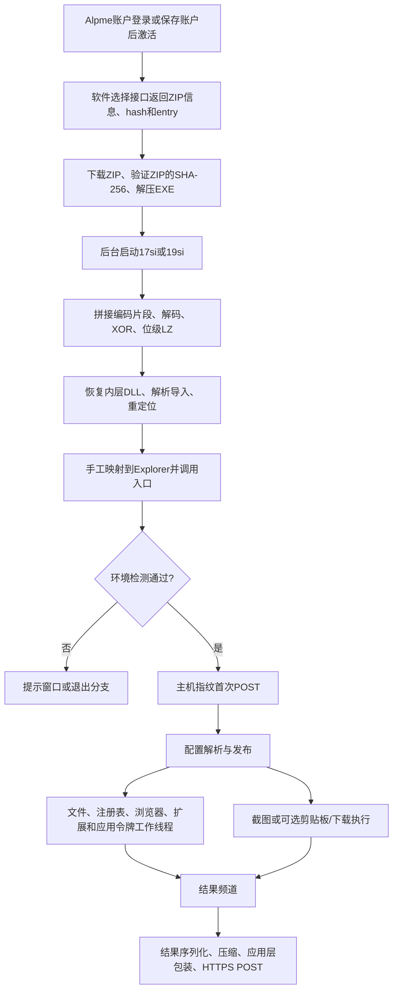

# 两个木马的行为流程

本页解释本地取得的两份样本。具体地址始终以“样本 + RVA”定位；完整参数和采集目录见PDF及CSV。

## 执行链

扩展的投递接口为 `/api/vscode/software/pick?platform=win`，请求头包含 `x-alpme-feat: zip`。响应的 `pick` 提供 `id`、`fileType=zip`、`sha256`、`entry`。验证对象是整个ZIP；`lastSha256` 保存包hash，`lastPath` 保存解压后的EXE路径。启动使用 `cmd.exe /c start "" /B`，并设置detached/windowsHide及unref。

## 外层PE与隐藏载荷

两个EXE均为原生AMD64 PE32+。窃密主体拆成编码片段，分散在外层 `.rdata` 和 `.data`：17共106片、633,187编码字节；19共196片、701,911编码字节。

17使用自定义6比特字母表，周期跳过噪声，再执行状态XOR和位级LZ；19使用另一套5比特字母表、噪声周期、XOR常量和LZ参数。恢复输出分别为647,168和642,560字节节数据。分析文件使用重建PE头；完整代码节已取回。字母表、种子、状态公式、长度字段、输出hash及全部302片位置均在报告和 `targets/payload-fragments.csv`。

加载器通过任务栏窗口取得Explorer PID，申请远程可执行内存，写入映像与启动代码，并创建远程线程。启动缓冲处理模块链表并进入DLL。主要内层代码在编译时已经存在，运行时另构造短启动代码和固定用途的调用桥。

## 沙箱提示窗口

已复现的门禁读取 `GetSystemFirmwareTable("RSMB")` 返回的SMBIOS，统计Type7缓存记录。查询成功但数量为0时显示标题 `yolo` 的提示窗口并返回；查询失败跳过该项。本案宿主记录为3，Windows Sandbox为0。提示文字试图阻止分析，并点名AI产品。还存在其他显示设备及键盘布局条件，详见报告。

## 云控操作与生命周期

| 功能 | 17 tag | 19 tag | 操作内容 |
|---|---|---|---|
| 截图 | C6 | A6 | GDI构造24位BMP |
| 普通浏览器 | E1 | 64 | Cookies、Login Data、History、Web Data等资料 |
| 文件/注册表 | D3 | 81 | 路径、匹配、深度、大小上限、专用处理器及注册表值 |
| 剪贴板替换 | 15 | DB | 十组币种地址配置 |
| 下载执行 | 83 | E3 | 下载并启动EXE、MSI或脚本 |

每次已审主入口在前置检查和初始包构造成功后只调用一次配置HTTP。传输失败后清理返回；配置发布后的主流程没有回到首次请求的边。后续结果频道可反复触发上传线程，上传响应仅检查和释放，不解析成新命令。HTTP短写补全和分块读取是同一事务的I/O循环。

17截图最多4次尝试、19最多3次，包含首轮；失败后分别请求等待112ms、78ms。成功构造BMP并交给结果频道后立即退出。剪贴板分支启用后则可持续检查变化，约674/676ms一次。

下载执行分支使用curl或certutil等工具落地，再通过ShellExecute、安装器或脚本解释器启动。控制端因此能够让受害用户上下文执行新程序，影响不限于内置采集器。

## 文件和应用数据

任务根可含环境变量或注册表路径表达式。按文件名匹配，支持星号、问号和否决规则；最大深度从根为0计算。大小上限按单文件处理，0表示不限。指定条件下会借用匹配的既有文件句柄，通过映射读取被占用文件。

325项任务的根、787条模式、深度、大小、selector和分类全部保存在 `targets/collection-tasks.csv`。目标覆盖AI/开发与云凭据、钱包、聊天/游戏会话、远程连接配置、密码库、文档、笔记及通用密钥文件。

专用处理包括Steam的ConnectCache/DPAPI、Roblox的CookiesData/Base64/DPAPI及 `.ROBLOSECURITY` 提取、Discord Local State键/LevelDB token/AES-GCM路径。虚构输入的明文字节已跟到结果槽和上传缓冲。加密密码库、钱包或其他容器仍需按自身保护方式分析；复制容器与取得明文秘密是不同结果。

## 浏览器磁盘资料与取钥

浏览器根发现使用APPDATA/LOCALAPPDATA的两层目录枚举。普通Chromium资料选择 `Default` 和区分大小写的 `Profile ` 前缀，后缀不要求数字。根发现和单profile采集的完整函数仍有待审分支，局部名字条件已经核实。

读取目标包括Local State、Last Browser、Login Data、Login Data For Account、Network/Cookies、History、Web Data、Preferences和相关存储。Gecko及两类浏览器扩展有独立的发现/采集路径，详见报告。扩展采集不由四个普通浏览器开关统一控制；276项表是排除词表。

普通浏览器wire0..4分别映射Cookies、登录数据、History、Web Data、保留字段；第五字段被保存但本地两份正常构建没有操作消费者。

内存核心接收候选PID，包含内存查询/读取、远程分配和写入、线程枚举、暂停、上下文保存/改写/恢复，以及同进程CryptUnprotectMemory调用准备。Chrome156仍使用同进程内存保护处理缓存键；APPB调用者验证、隔离状态绑定和Process Isolation则是另外需要满足的条件。真实Chrome156对象命中、取钥和认证解密尚未完成现场验证。

19通过Local State裸字段名提取 `encrypted_key`、`app_bound_encrypted_key`、`aster_app_bound_encrypted_key`，经Base64后分别剥除5/4/4字节。准备variant取决于解码结果可用性：普通门要求encryption_key；Aster门额外要求aster_encryption_key。候选缺所需结果时继续下个PID。legacy键还有CryptUnprotectData回退。

19创建进程前查询TokenElevation；可使用普通CreateProcessW，也可查询Shell进程令牌并复制主令牌供CreateProcessWithTokenW使用。命令行只转换传入EXE路径，没有追加临时profile、headless或远程调试参数。隐藏桌面名为yuirdsuiast。已存在进程guard只关句柄；created guard的终止标志为1，在后续资料处理完成后按状态终止对应进程。

## 上传包装与额外文件访问

内层向 `hebaoshi[.]co:443` 发送 `POST /`；User-Agent分别为foumootts与swoellsiaps。域名在样本中由编码字符串恢复。应用层使用由本地常量/状态构造的固定通信键及SHA-256派生数据流包装，请求/回复还有压缩和版本字段。完整键、nonce派生规则和包布局说明见PDF。

四份离线截获请求经独立还原，分别包含虚构截图、Codex认证文件、GitHub CLI和Claude Code文件字节。真实首次配置回复使用合成指纹取得；后续采集与发送实验在离线模型中完成。

ENE路径 `C:\ProgramData\ENE\aiantionk` 是读到EOF后丢弃：payload立即释放，长度在使用前也被覆盖。ShareX路径 `C:\ProgramData\ShareX\swaontzuiests.cfg` 是20字节固定常量的创建/截断写入。其他固定写入、完整字节内容和残留位置见PDF附录与 `iocs.csv`。
